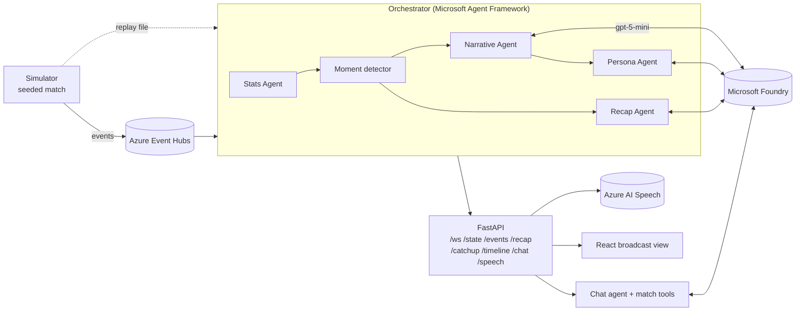
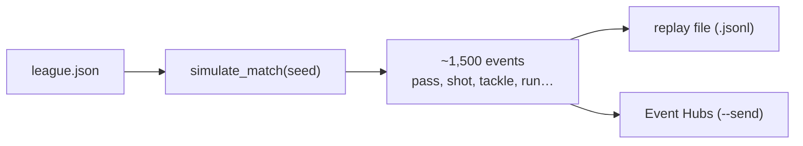
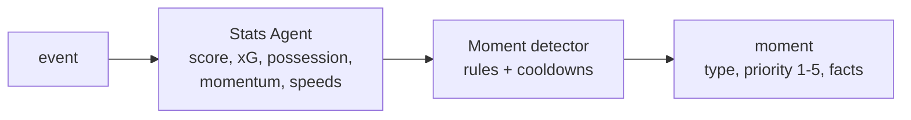
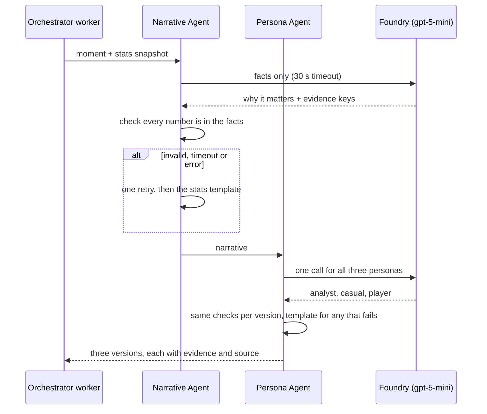
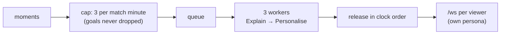
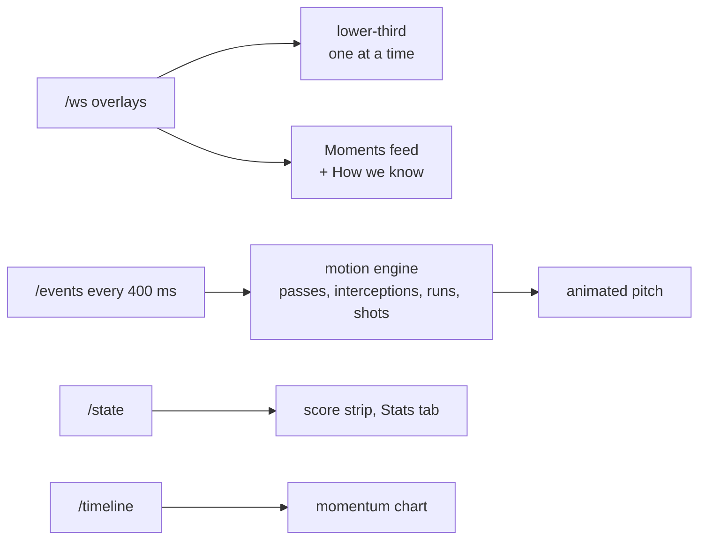
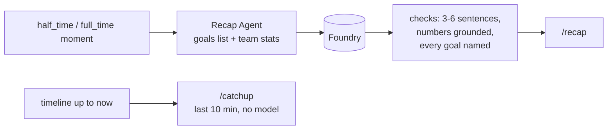
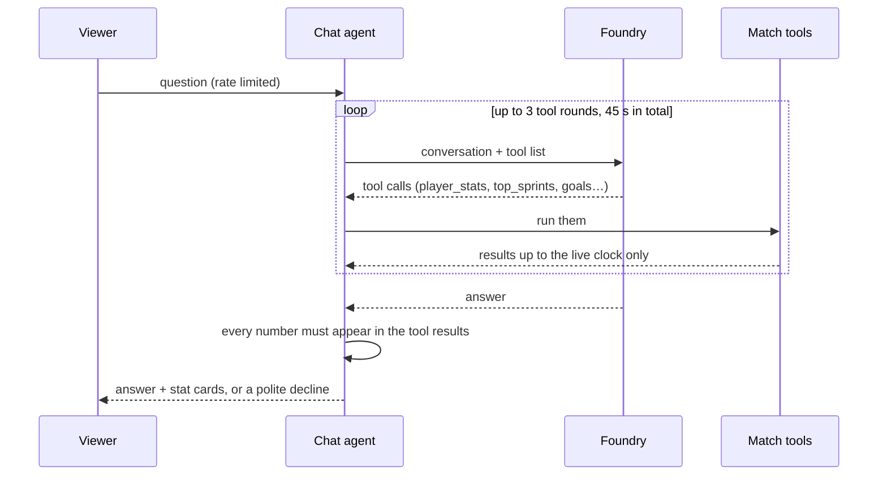
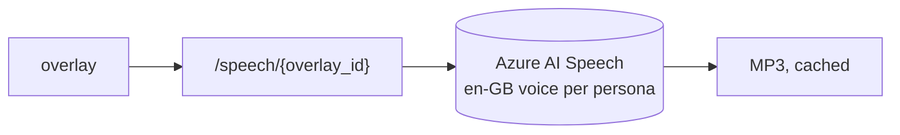

# Deepkick

**AI match intelligence for the Microsoft × Premier League "Inside the Game" hackathon.** Deepkick turns a stream of football events into explained, timed, personalised broadcast overlays, recaps and a match chat, with every number traced back to the data.

| Desktop, light | Desktop, dark | Phone |
|---|---|---|
|  |  |  |


All clubs, players, stadiums and referees are fictional ([`data/league.json`](data/league.json)). The full design notes for every stage are in [`docs/REFERENCE.md`](docs/REFERENCE.md).

## What it does

- **Explained moments:** goals, big chances, pressure spells, momentum swings, sprints and milestones are detected from the stats, then a Foundry model says *why* each one matters.
- **Three personas:** every moment is written for an Analyst, a Casual fan and a Player-focused viewer. Switching persona changes the text already on screen.
- **Timed overlays:** a lower-third on an animated pitch, plus a feed of moment cards, each with a **How we know** list of the exact facts it cites.
- **Recaps and catch-up:** half-time and full-time recaps, and a spoiler-safe "Catch me up" for the last 10 minutes.
- **Ask the match:** a chat answered only from match tools. It declines rather than guesses.
- **Spoken commentary:** optional Azure AI Speech voice per persona.
- **Never blank:** every model call has a timeout and a template fallback, so an overlay always ships.

## Architecture



One orchestrator reads the stream (Event Hubs Basic has one consumer group) and fans out to every viewer. Stats, moments, priorities and overlay timing are plain Python; only the text comes from the model.

## How each part works

### 1. Ingest: simulator



Same seed, same match: seed 42 is **Ashvale 3-5 Calderbrook**, 1,497 events. The player on the ball is chosen near the ball from the team shape, so the pitch never has to teleport anyone. [`deepkick/simulator.py`](deepkick/simulator.py)

```bash
.venv/bin/python -m deepkick.simulator --seed 42 --out replays/ASH-CAL-42.jsonl
```

### 2. Interpret: Stats Agent and moment detector



No model calls. Seed 42 yields 44 moments (8 goals, 12 sprint milestones, 6 momentum swings…). [`deepkick/stats.py`](deepkick/stats.py), [`deepkick/moments.py`](deepkick/moments.py)

### 3. Explain and personalise: Narrative and Persona Agents



Only priority 2+ moments call the model (22 on seed 42); the rest use templates. A 429 waits 2 s, 4 s, 8 s (or Retry-After) without using up an attempt. [`deepkick/agents/narrative.py`](deepkick/agents/narrative.py), [`deepkick/agents/persona.py`](deepkick/agents/persona.py)

### 4. Render: orchestrator and overlay API



Model calls run concurrently, but overlays are always released in match-clock order. Each viewer gets the backlog first, then live overlays in their own persona. Every handoff is logged (`stage, event_id, duration_ms, fallback`). [`deepkick/orchestrator.py`](deepkick/orchestrator.py), [`deepkick/api.py`](deepkick/api.py)

### 5. Broadcast view



React + Vite, light and dark themes, keyboard accessible, reduced-motion aware. Layout from 1280 px: **Ask the match | the match | Moments**. Players move at a sprinter's capped speed, the ball travels between them, and a queue catches up when the replay runs fast. [`web/src`](web/src)

### 6. Recap and catch-up



A recap that leaves out a goal falls back to its template. Catch-up never shows anything past the live clock. [`deepkick/agents/recap.py`](deepkick/agents/recap.py)

### 7. Ask the match



The tools read only events already played, so answers are spoiler-safe. Cards are built in Python from tool results, never by the model. [`deepkick/agents/chat.py`](deepkick/agents/chat.py), [`deepkick/agents/match_tools.py`](deepkick/agents/match_tools.py)

### 8. Spoken commentary



Off by default; a 10 s timeout and one retry, then silence (the text overlay still shows). [`deepkick/agents/speech.py`](deepkick/agents/speech.py)

## Reliability rules

| Situation | What happens |
|---|---|
| Model timeout or error | One retry, then a template built from the stats; logged |
| Model invents a number | Rejected, retried once, then the template |
| 429 rate limit | Wait 2 s, 4 s, 8 s (or Retry-After, max 30 s); not counted as a failure |
| Speech fails | No audio; the overlay still shows |
| Chat can't ground an answer | Declines and shows the tool results as cards |
| Too many chat requests | 429 after 6 per minute per client or 30 per minute in total |

## Run it locally

```bash
python3.11 -m venv .venv && .venv/bin/pip install -r requirements.txt
cp .env.example .env    # optional: FOUNDRY_*, AZURE_SPEECH_*, EVENTHUB_*; without them everything uses templates
(cd web && npm install)
```

```bash
# Terminal 1: the API, replaying seed 42 at 30x (90 minutes in 3)
REPLAY_FILE=tests/fixtures/replay_ASH-CAL-42.jsonl REPLAY_SPEED=30 .venv/bin/uvicorn deepkick.api:app --port 8000
```

```bash
# Terminal 2: the broadcast view on http://localhost:5173
cd web && npm run dev
```

## Deploy a live demo to Azure

One Azure Container App runs everything: the [`Dockerfile`](Dockerfile) builds the site and serves it from the API, so the page, the REST endpoints and the WebSocket share one URL. Azure builds the image, so Docker isn't needed locally.

1. **Install the Azure CLI and sign in** (once):

   ```bash
   brew install azure-cli
   ```

   ```bash
   az login && az extension add --name containerapp --upgrade && az provider register -n Microsoft.App && az provider register -n Microsoft.OperationalInsights
   ```

2. **Build and deploy** from the repo root (pick a region near you, for example `uaenorth`):

   ```bash
   az containerapp up --name deepkick --resource-group deepkick-rg --location uaenorth --source . --ingress external --target-port 8000
   ```

3. **Add the keys as secrets.** This reads them from your `.env` into the shell, so they are never typed or committed:

   ```bash
   set -a; source .env; set +a; az containerapp secret set -n deepkick -g deepkick-rg --secrets foundry-key="$FOUNDRY_API_KEY" speech-key="$AZURE_SPEECH_KEY"
   ```

   ```bash
   az containerapp update -n deepkick -g deepkick-rg --min-replicas 1 --max-replicas 1 --set-env-vars FOUNDRY_ENDPOINT="$FOUNDRY_ENDPOINT" FOUNDRY_MODEL_DEPLOYMENT="$FOUNDRY_MODEL_DEPLOYMENT" FOUNDRY_API_KEY=secretref:foundry-key AZURE_SPEECH_REGION="$AZURE_SPEECH_REGION" AZURE_SPEECH_KEY=secretref:speech-key
   ```

   Keep exactly one replica: the match state lives in memory, and one orchestrator serves every viewer.

4. **Get the URL** and put it at the top of this README and in the GitHub repo's *About → Website*:

   ```bash
   az containerapp show -n deepkick -g deepkick-rg --query properties.configuration.ingress.fqdn -o tsv
   ```

5. **Replay the match again** for a new visitor or for judging (the replay plays once, 3 minutes at 30x; set `REPLAY_SPEED=10` for 9 minutes):

   ```bash
   az containerapp revision restart -n deepkick -g deepkick-rg --revision $(az containerapp show -n deepkick -g deepkick-rg --query properties.latestRevisionName -o tsv)
   ```

6. **Stop paying** after judging:

   ```bash
   az group delete -n deepkick-rg --yes
   ```

The public chat spends Foundry tokens, so it is rate limited (6 questions per minute per visitor, 30 in total).

## Tests

```bash
.venv/bin/python -m pytest -q                 # 339 tests, ~30 s, no network: Azure settings are blanked for the session
cd web && npm test && npm run build           # 23 tests: pitch layout, motion, overlay timing, theme
```

Everything is tested against a fixed-seed replay ([`tests/fixtures/replay_ASH-CAL-42.jsonl`](tests/fixtures/replay_ASH-CAL-42.jsonl)) with fake model clients. GitHub Actions runs the Python suite on every push. [`scripts/chat_eval.py`](scripts/chat_eval.py) runs 12 fixed questions against the real deployment: last run 11 of 12 grounded, median 5.9 s (the declined one was a prompt injection).

## Project layout

```
data/league.json          fictional clubs and squads
deepkick/simulator.py     match simulator and Event Hubs producer
deepkick/stats.py         Stats Agent
deepkick/moments.py       moment detector
deepkick/agents/          narrative, persona, recap, chat (+ match tools), speech
deepkick/orchestrator.py  Agent Framework workflow
deepkick/api.py           FastAPI: overlays, state, events, recap, catch-up, timeline, chat, speech, the built site
web/                      React broadcast view
tests/                    pytest suite and the seed-42 replay
docs/REFERENCE.md         full design notes for every stage
```

## Azure services

| Service | Used for |
|---|---|
| Microsoft Foundry (gpt-5-mini) | narratives, personas, recaps, match chat |
| Microsoft Agent Framework | the Explain → Personalise workflow per moment |
| Azure Event Hubs | live event stream (replay files work without it) |
| Azure AI Speech | spoken commentary |
| Azure Container Apps | the live demo |
